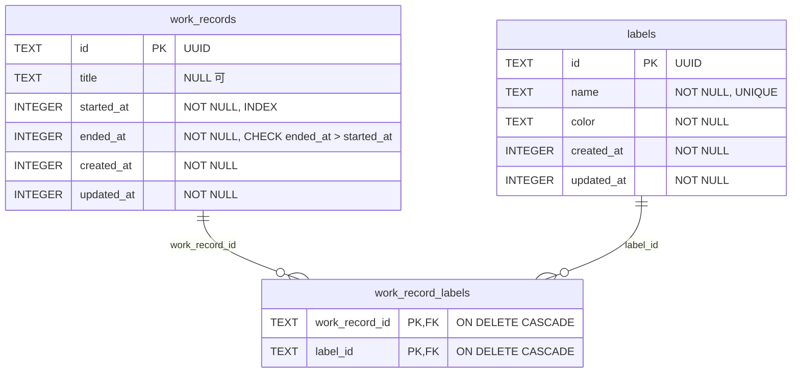

# テーブル設計（D1）

移行後の D1 のテーブル。**実装前の設計**。現状の Notion DB は [notion-db.md](notion-db.md) にある。

## ER 図

## 方針

- 日時は UTC の UNIX 時刻（ミリ秒）で保存する
  - 日の区切りはクライアントが計算し、API には時点（`from` / `to`）で渡す
  - API の JSON では ISO 8601（`2026-10-25T01:00:00.000Z`）で返す
- 削除は物理削除。誤削除は D1 の Time Travel で戻す
- 1 件の作業記録にラベルを複数付けられる（`work_record_labels`）
- 作業記録は終了してから作る。計測中の状態はサーバーに保存しない
- `title` は NULL を許可する（フォームで任意入力のため）
- `color` はアプリ独自の色の値（`#3b82f6` など）
- 利用者は 1 人なので `user_id` は持たない

## Notion からの変更点

| Notion | D1 |
| --- | --- |
| ラベルを名前の文字列で指定 | `labels.id` で参照する |
| ラベルは 1 つだけ | 複数付けられる |
| 色は Notion の色名（`blue`）を `colorMap.ts` で変換 | 色の値を直接保存する |
| ページ ID・ページ URL | 自前の UUID。URL は持たない |
| アーカイブ（`archived: true`） | 物理削除 |
| 開始と終了の前後チェックはフォームだけ | DB の `CHECK` 制約でも確かめる |

## スコープ外

- 優先度付きの Todo（UI の `WorkCard` / `PriorityBadge`）
